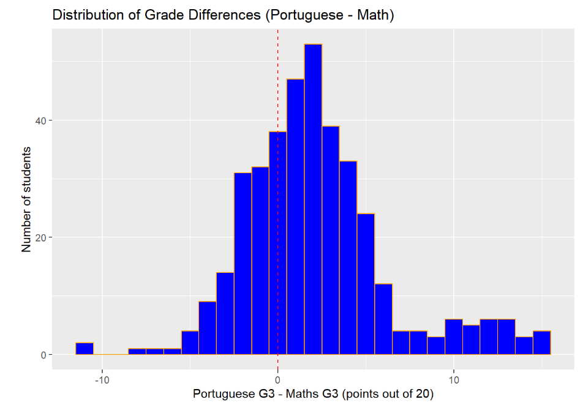
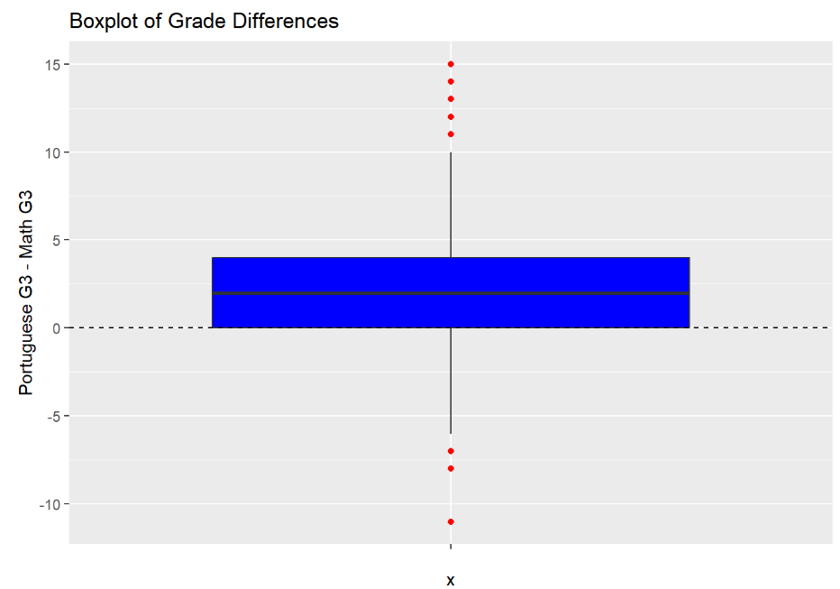
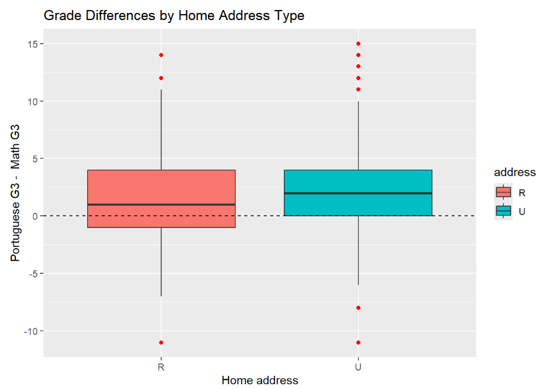
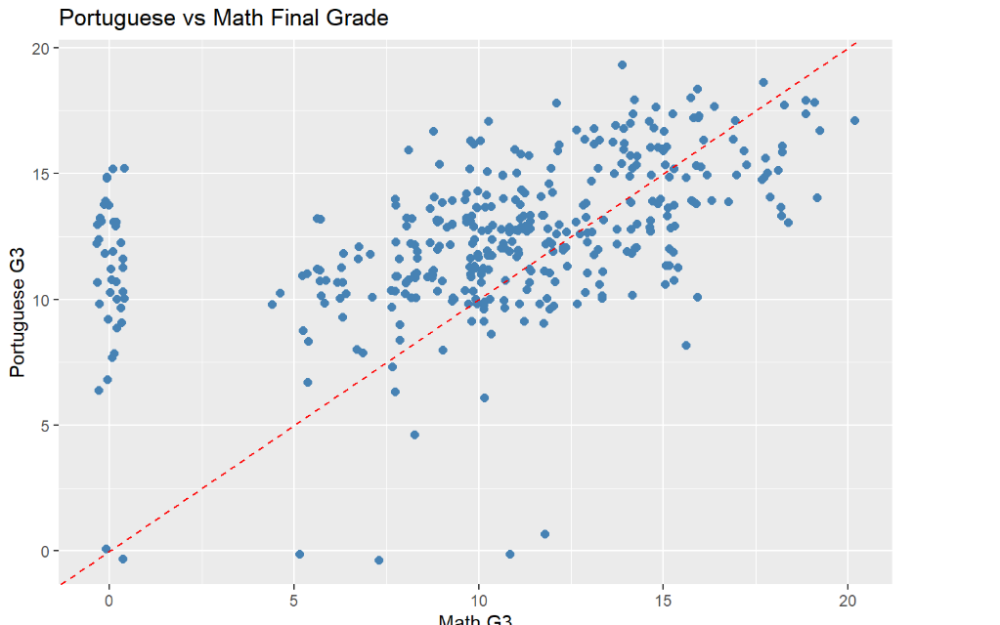
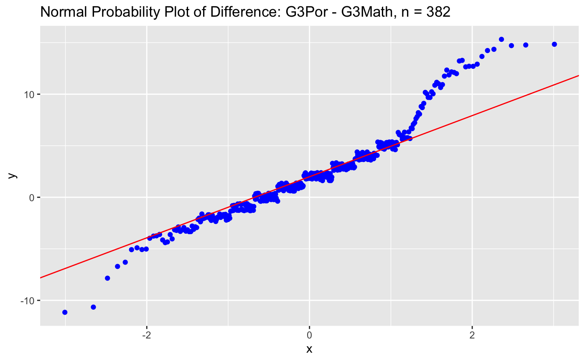

# Student Academic Performance: Portuguese vs Mathematics

A statistical analysis comparing secondary school students' final grades in Portuguese and Mathematics, and testing whether urban students outperform rural students. Completed as the final group project for **DATA 602** (University of Calgary, Certificate in Data Science and Analytics).

**Team:** Mariam Adekanye, Bushra Fatima, Sagar Gupta, and Qahir Ramji

---

## Research Questions

1. **Method 1:** For students who take both courses, are average final grades higher in Portuguese than in Mathematics?
2. **Method 2:** Do students from urban regions have higher average final grades than students from rural regions? This is tested separately for Mathematics and Portuguese.

All tests use a significance level of **α = 0.05**.

## Data

| | |
|---|---|
| **Source** | [UCI Machine Learning Repository: Student Performance](https://archive.ics.uci.edu/dataset/320/student+performance) |
| **Original study** | Cortez & Silva (2008). Two secondary schools in Portugal, 2005–2006 school year |
| **Collection** | School reports and student questionnaires |
| **Files** | `student-mat.csv` (Mathematics) and `student-por.csv` (Portuguese), semicolon-separated |
| **License** | [CC BY 4.0](https://creativecommons.org/licenses/by/4.0/) |
| **Outcome** | `G3`, the final grade on a 0–20 scale |

### Data preparation

- The two course files were merged on 13 shared background variables: school, sex, age, address, family size, parents' cohabitation status, mother's and father's education and job, reason for choosing the school, nursery attendance, and internet access. This identifies students enrolled in **both** courses: **n = 382**.
- The merged data was reduced to the variables of interest, and the columns were renamed (`G3_math`, `G3_por`, `studytime_math`, and so on).
- A new variable was created for each student:

> **G3_diff = G3_por − G3_math**

A positive value means the student scored higher in Portuguese.

| Group | n | Mean Math G3 | Mean Portuguese G3 |
|---|---|---|---|
| Urban | 301 | 10.61 | 12.80 |
| Rural | 81 | 9.56 | 11.44 |

## Repository Structure

```
├── data/
│   ├── student-mat.csv
│   ├── student-por.csv
│   └── student-merge.R          # dataset authors' merge script
├── report/
│   ├── final_report.Rmd         # analysis + write-up (R Markdown)
│   └── final_report.pdf
├── figures/                     # plots shown in this README
├── presentation/
│   └── Data_602_Presentation.pptx
└── README.md
```

## Exploratory Data Analysis

### Distribution of grade differences

<p align="center"></p>

The distribution is right-skewed. Most differences fall between −4 and +6, where the shape is roughly bell-shaped, and a long right tail extends to about +15. Students generally tend to score higher in Portuguese than in Mathematics.

### Boxplot of grade differences

<p align="center"></p>

The median difference is **+2**, and the middle 50% of students fall between 0 and +4.

### Grade differences by home address (urban vs rural)

<p align="center"></p>

Urban (U) students have a slightly higher median grade difference than rural (R) students. The boxes overlap substantially.

### Mathematics vs Portuguese final grades

<p align="center"></p>

There is a moderately positive relationship (**r ≈ 0.48**): students who do well in one subject generally do well in the other. This supports treating the two grades as paired observations. The vertical cluster at Math = 0 is the group of students with a zero Mathematics grade (see [Limitations](#limitations)).

## Condition Checking

**Paired t-test (Method 1)**
- **Normality:** The Normal Q-Q plot of `G3_diff` is approximately linear through the centre, with some departure in the tails. With n = 382, the Central Limit Theorem supports the t-procedure.

<p align="center"></p>

- **Paired observations:** Each Math and Portuguese grade belongs to the same student, identified by merging the two course files.
- **Independence:** The original study was observational, so independence of pairs cannot be guaranteed by design.
- **Random sampling:** The original study randomly selected questionnaires and report-card records from two schools. Sampling is reasonably addressed, but generalization is limited.
- A **bootstrap** confidence interval, which does not rely on Normality, was calculated as a robustness check.

**Welch two-sample t-test (Method 2)**
- Normal Q-Q plots were examined for each group: urban (n = 301) and rural (n = 81), for both subjects. Both groups have n ≥ 25, so the CLT applies.

## Results

### Method 1: Paired t-test (Portuguese vs Mathematics)

**H₀:** μ_d ≤ 0  **Hₐ:** μ_d > 0, where μ_d = μ_G3Portuguese − μ_G3Math

| Statistic | Value |
|---|---|
| Mean difference | 2.128 |
| t_obs (df = 381) | 9.977 |
| P-value | < 2.2 × 10⁻¹⁶ |
| 95% CI (t) | 1.709 ≤ μ_d ≤ 2.548 |
| 95% CI (bootstrap, 2,000 resamples) | 1.694 ≤ μ_d ≤ 2.542 |

**Conclusion:** We reject H₀. Students who took both courses scored on average about **2.1 points higher in Portuguese** than in Mathematics, out of 20. Both intervals lie entirely above 0 and agree closely, so the result is robust to the departure from Normality in the tails.

### Method 2: Welch two-sample t-test (urban vs rural, one-sided)

**H₀:** μ_Urban − μ_Rural ≤ 0  **Hₐ:** μ_Urban − μ_Rural > 0

| Subject | t_obs | df | P-value | 95% lower bound (t) | 95% lower bound (bootstrap) |
|---|---|---|---|---|---|
| Portuguese | 3.172 | 105.0 | 0.00099 | 0.648 | 0.702 |
| Mathematics | 1.835 | 129.3 | 0.0344 | 0.102 | 0.126 |

**Conclusion:** In both subjects we reject H₀. On average, urban students score higher than rural students. The evidence is **strong for Portuguese**: urban students score at least 0.65 points higher. It is **considerably weaker for Mathematics**: the P-value is close to 0.05 and both lower bounds are close to 0, which matches the heavy overlap in the boxplots.

## What We Cannot Conclude

- **No cause and effect.** The data is observational: students were not randomly assigned to a region or a course. We cannot conclude that Mathematics is inherently harder, or that living in an urban region causes higher grades. Factors such as family income and parental education may contribute.
- **Limited generalization.** The data comes from two schools in a single region during one school year, and only the 382 students enrolled in both courses. The results apply best to students in similar schools and circumstances.

## Limitations

1. **Zero grades were retained.** Several students received a Mathematics final grade of 0 alongside typical Portuguese grades. These zeros likely reflect a missed final assessment or a withdrawal, and they may inflate the mean difference in Method 1.
2. **Independent groups in Method 2.** Urban and rural students are different people. Differences other than location, such as a higher proportion of strong students in one group, could explain part of the gap.
3. **No student ID.** Records were matched on background characteristics, so two students with identical characteristics (for example, twins at the same school) could be mismatched. That would affect the paired differences.

## Reproducing the Analysis

Required R packages:

```r
install.packages(c("dplyr", "ggplot2", "mosaic", "readr"))
```

1. Clone this repository and open the project folder in RStudio.
2. Open `report/final_report.Rmd` and knit it, or run the chunks in order.
3. Bootstrap results use `set.seed(3)` with N = 2,000 resamples, so the numbers reproduce exactly.

## References

- Cortez, P. (2008). *Student Performance* [Dataset]. UCI Machine Learning Repository. https://doi.org/10.24432/C5TG7T
- Cortez, P., & Silva, A. M. G. (2008). Using data mining to predict secondary school student performance. In A. Brito & J. Teixeira (Eds.), *Proceedings of the 5th Future Business Technology Conference (FUBUTEC 2008)* (pp. 5–12). EUROSIS.
